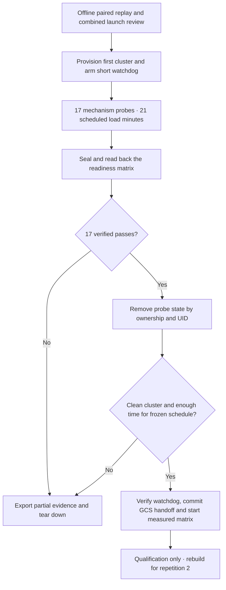
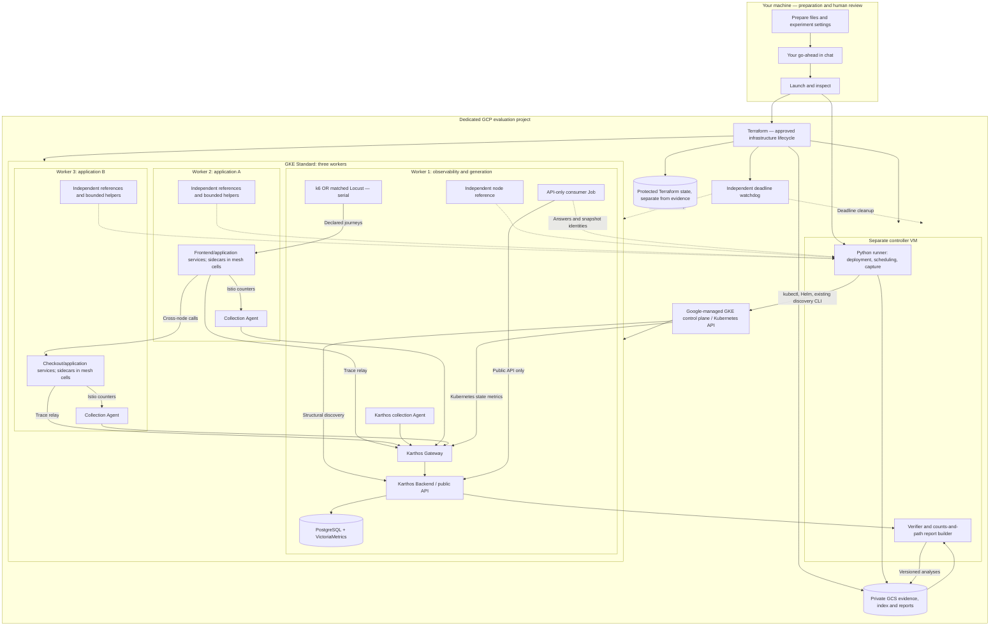
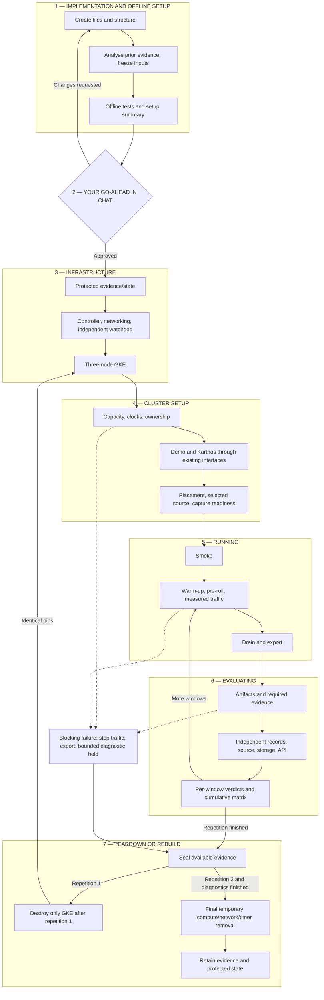
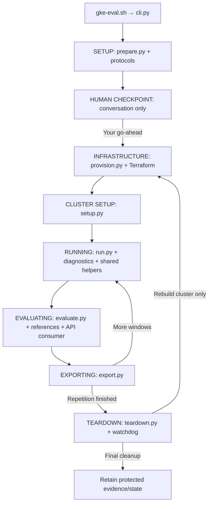

> Historical qualification/rehearsal reference. New preparations and launches use [thesis qualification v3](thesis-qualification-v3.md), with 13 k6-only readiness probes. The generator matrices below describe legacy evidence.

# GKE qualification v1: execution plan

**Human checkpoint:** I prepare the files and explain the setup here in chat. You check it and tell me when to proceed. There are no review commands, approval receipts, signatures or review IDs. Creating files and passing tests do not mean “start the cloud run.”

This is a qualification of Karthos's normalized data foundation on two newly created managed clusters. It does not establish production scale, optimal window duration, runtime source failover, or causal instrumentation overhead. Collection Agents are OpenTelemetry collectors; the shopping-agent scenario is excluded.

## Frozen experiment

| Input | Definition |
|---|---|
| Infrastructure | Dedicated GCP project; zonal GKE Standard, us-central1-a |
| Compute | Three fixed on-demand e2-standard-4 workers, separate e2-standard-4 controller |
| Placement | Observability/generators; application A; application B |
| Controller storage | 300 GB boot/data disk; 100 GiB raw-evidence budget plus sealed archives and checked temporary headroom |
| Applications and sources | Boutique and Astronomy, one at a time; trace servicegraph and Istio |
| Generators | Matched k6 and matched Locust, serial, two journeys/second |
| Repetitions | Two cluster creations; controller and evidence survive rebuild |
| Smoke / baseline | 60 seconds / 300 seconds; reversed generator order in repetition 2 |
| Preserved timing | 60-second pre-roll, 90-second drain, bounded quiet-counter check, 250 ms clock gate |
| Limits | US$100 gross planning ceiling, <=US$80 launch estimate, 12-hour infrastructure clock including rebuild/cleanup |
| Recovery | Stop new traffic and export; maximum 30-minute diagnostic hold within remaining reserves |
| Retention | Private GCS, minimum 90 days; verified secondary export before intentional deletion |
| Excluded | Native Locust, shopping agent, GPU, production-scale and causal-overhead claims |

| Phase | Windows | Stimulus |
|---|---:|---:|
| Smoke: four cells × two generators × two clusters | 16 | 16 minutes |
| Baseline: four cells × two generators × two clusters | 16 | 80 minutes |
| CPU/memory, storage and cross-node network × two clusters | 6 | 30 minutes |
| Both sources; explicit redeployment with Istio unavailable × two clusters | 4 | 20 minutes |
| Checkout and Gateway restart × two sources | 4 | 20 minutes |
| Total | 46 | 166 minutes |

Stimulus time excludes deployment, warm-up, collection pre-roll/drain, export, rebuild and teardown. Five minutes is provisional. More minutes do not repair missing evidence.

## Watchdog admission readiness

Before temporary compute is created, the first authenticated watchdog dry-run may retry
HTTP 403 up to six times at 20-second intervals while its newly created invoker
policy propagates. It retries the same candidate endpoint, token and pinned inventory.
Persistent denial and other request failures stop provisioning. The gate still requires
a successful authenticated response before compute creation. Existing armed watchdog
refreshes retain their immediate failure behavior.

## Required readiness before measured traffic

Every new rehearsal, qualification or thesis launch includes the 17-probe readiness check.
Review and authorize the combined launch in chat before provisioning. The two-hour
readiness limit begins at provisioning and uses the same 12-hour infrastructure
allowance. The watchdog keeps that shorter limit until it reads a create-only
GCS handoff tied to the current run, lease, and verified inventory. It checks the
storage creation time against the readiness reserve and remaining-study forecast.
An absent, unreadable, late, or mismatched handoff keeps the shorter deadline. Reserve the last 20 minutes of readiness for failed-run export and
teardown. The combined cost gate remains US$80 projected and US$100 gross.



| Group | Mechanisms |
|---|---|
| Astronomy Istio | Matched Locust and k6 |
| Boutique Istio | Matched k6 and Locust, both-source selection, checkout restart, Gateway restart |
| Boutique trace | Explicit rediscovery and redeployment, matched k6 and Locust, cross-node network, CPU/memory, PVC I/O, checkout restart, Gateway restart |
| Astronomy trace | Matched k6 and Locust |

Each case is 60 seconds except cross-node network, which is five minutes and
uses the full production archive path. Compact cases retain generator evidence
and mechanism observations, source and collector proof, and selected public API
samples. Resource helpers and restarts have their own UID-scoped evidence.
Readiness queries cumulative checkout counters with explicit `latest` aggregation.
A pass requires selected-source activity in the same series or a fresh raw
counter observation corroborated by current-probe calls. Measured-window accuracy verdicts come
from the frozen schedule. Probe output lives under `readiness/` in the run and
in the private GCS run prefix. A verified case export includes readback.
Run-wide timing records include monotonic wall time, process CPU and peak RSS,
archive and transfer bytes, and the last completed phase.

The handoff verifies removal of probe namespaces, PVCs, reclaimed volumes and
cluster-scoped additions, then takes a fresh cumulative host baseline on each
worker. It forecasts the remaining work using the slower representative
estimate for each duration, observed setup, rebuild where applicable, and
cleanup. The archived full-window estimate already includes setup. Compare it
with the live per-window estimate plus any applicable setup before taking the
slower estimate. Missing timing evidence or an estimate beyond the deadline blocks
measurement. The qualification's rebuilt cluster runs the existing preflight
and matching smokes.

Before preparing a combined launch, use the offline benchmark entry point with
the four checksum-verified historical inputs, a saved pre-change export module,
and a fresh report path. The replay runs in Linux with three alternating pairs
per input and requires a median reduction of at least 30% on each five-minute input. Use the passing report with `gke-eval.sh prepare --benchmark`.
Preparation records the separate readiness matrix and binds the replay to the
current privacy implementation. Review the replay and exact combined launch
before the first live use.

## Diagnostic rehearsal

Prepare this separate one-cluster schedule with `gke-eval.sh prepare --schedule diagnostic-rehearsal` and the usual configuration, preparation ID and product snapshot. It runs to the end of its 16-window schedule within the infrastructure deadline. The 46-window qualification remains the default.

| Phase | Cases | Scheduled load |
|---|---|---:|
| Smoke | Astronomy trace k6, Boutique Istio k6 and Locust, Astronomy Istio Locust and k6 | 5 min |
| Baseline | Astronomy trace k6 and Boutique Istio Locust, gated by matching smoke on this cluster | 10 min |
| Resource | Boutique trace k6 with CPU/memory, PVC I/O, then cross-node traffic | 15 min |
| Arbitration | Boutique k6 with both sources, then explicit rediscovery and redeployment to trace | 10 min |
| Restart | Boutique k6 checkout then Gateway under trace, then both targets under Istio | 20 min |

Each restart starts with a clean deployment. Restart completion requires a newly observed deployment generation and a distinct, Ready set of owned Pods. Capture setup waits within the rollout budget for its exact owned collector pods to become Ready. For a planned Gateway restart, the capture watchdog records the exact window annotation before installing instrumentation and verifies the full template when restoring it. An expected disruption with valid diagnostic evidence may leave traffic scoring incomplete. Missing required evidence, an unverified export or the cleanup reserve stops new traffic and leaves a reason in the partial matrix. Numerical disagreement is retained as a result.

The rehearsal matrix separates execution, evidence validity, application outcomes and numerical agreement. Keep its run ID separate from the qualification and attach the independent cleanup receipt to the local analysis. Cluster rebuild and cross-cluster repeatability remain part of the full qualification.

## Runtime architecture



Arrows describe responsibilities, not public exposure. The consumer has no Kubernetes/database credentials or raw-evidence mounts. Trace and mesh are serial except the explicit arbitration diagnostic. The controller uses the private cluster endpoint; the operator uses public provider APIs for infrastructure provisioning, not a default kubectl context.

## Architectural execution phases



Final cleanup must not depend on this chat being alive. GCP deletes asynchronously: the watchdog requests deletion and records residuals; it cannot promise the precise instant billing stops. After a verified sealed summary export, the external watchdog also accepts a generation-pinned completion request. It verifies those export bytes independently, deletes only matching owned UIDs, confirms compute absence before removing NAT/router/firewall/subnet/network, records observations in GCS, and pauses its timer only after confirmed absence. Deadline cleanup remains independent of that completion request. The cold Cloud Run service definition remains configured with zero minimum instances; an invocation cannot prove its own instantaneous scale-to-zero. Explicit operator teardown can remove that retained definition. A deadline is not a billing cap. Billing alerts do not enforce the US$100 limit.

## Files and responsibilities

```text
karthos-tcc-evaluation/
├── gke-eval.sh                 thin Python command wrapper
├── config/gke.example.yaml     environment and unresolved operator inputs
├── protocols/gke-qualification-v1/
│   ├── protocol.yaml           schedule, repetitions and gates
│   ├── metrics.yaml            representative accuracy/reference rules
│   ├── coverage.yaml           all 43 catalog entries
│   └── queries.yaml            public-API consumer questions
├── infrastructure/
│   ├── terraform/{foundation,controller,cluster}/
│   ├── controller/{Dockerfile,startup.sh,verify_bundle.py}
│   ├── watchdog/main.py
│   └── helpers/{Dockerfile,reference_sampler.py}
├── evaluation/
│   ├── gke/{cli,models,context,prepare,bundle}.py
│   ├── gke/{provision,setup,run,evaluate,export,teardown}.py
│   ├── gke/diagnostics/{resources,arbitration,restarts}.py
│   ├── references/{kubelet,host,filesystem}.py
│   ├── consumers/api_only.py
│   ├── structured_capture.py   node/pod/collector-aware capture
│   ├── timing_capture.py       independent evidence and clocks
│   ├── generator_{execution,artifacts}.py
│   ├── workloads/{run.js,matched_locust.py}
│   └── tests/test_gke_*.py
├── docs/gke-qualification-v1.md
├── build/gke/{bundles,prepared}/<experiment-id>/
├── .work/gke/<run-id>/
├── results/gke-qualification-v1/runs/<run-id>/
└── analyses/gke-qualification-v1/<run-id>/<analysis-id>/
```

Protocol files own experiment rules; Terraform owns infrastructure; Python coordinates. They are JSON-compatible YAML so preparation can use the standard library. Helm/Istio manifest processing uses pinned PyYAML in the controller toolchain.

`gke-eval.sh` is a command wrapper, not a second scheduler. `build/gke` contains reproducible generated experiment packages, never credentials or historical results. `.work/gke` is private scratch, execution locks, the run manifest and Terraform operational state. It is never research evidence. `results` contains sealed execution observations; `analyses` contains versioned interpretations referencing original checksums, so corrected scoring never rewrites an original run.



## Comparisons and truthful limitations

The chain is generator ledger → frontend observer → selected internal observer → raw trace/Istio → collector output → VictoriaMetrics → public API. The configured schedule is stimulus, not observed request truth. HTTP and gRPC outcomes retain both statuses and source policy. Expected injected errors remain measured failures; intended application outcomes are separate.

Every window reports execution, required evidence, eventual accounting, exact storage/API parity, fixed-window fidelity, visibility, application outcomes and resource agreement separately. Reset handling precedes aggregation; series identity includes every preserved semantic dimension. Means require equivalent populations and matching sum/count partitions. Absent/ambiguous series are insufficient, never zero. Do not widen tolerances to obtain agreement.

Resource conversion, preservation and independent agreement are distinct. Proc acquisition time is not the receiver's underlying gauge measurement timestamp. The evaluator deliberately reports insufficient independent host alignment where that timestamp or exact mapping cannot be established. It retains raw values, dimensions and reference records rather than inventing a passing accuracy result. Disk sector/rate conversion, filesystem device mapping, some volume/lifecycle references need deployed-source evidence. Offline fixtures cannot establish independent-VM accuracy.

Full catalog coverage is an inventory, not 43 successful numeric accuracy claims. Representative selections and explicit unexercised/unsupported/missing classifications are recorded in the experiment definition. Unexpected numerical disagreement is a valid result. A confirmed Karthos defect stops the study and requires direction; it is not repaired silently during frozen measurement.

Historical timing evidence remains unchanged. The preparation records baseline report hashes, source pins and observed limitations. Both cluster creations compare declared structure and correct per-run identities, not equal generated UIDs or values.

## How we proceed

1. I prepare the configuration, manifests and scripts, and run offline checks.
2. I show you the architecture, intended scenarios, pending inputs and test outcome in this conversation.
3. **I stop and wait for your explicit go-ahead here.** You do not need to run any command to review or approve the setup.
4. Once you tell me to proceed and the technical inputs are ready, I provision, run, export, evaluate and clean up.

The harness keeps ordinary commands for doing the work: `prepare`, `provision`, `run`, `status`, `export`, `analyse` and `teardown`. `runtime` is the controller's internal entrypoint. There are no `approve`, `verify-authorization` or review-package commands.

For reference, execution uses a prepared manifest rather than a review ID:

```sh
./gke-eval.sh prepare --config config/gke.example.yaml --id gke-v1 \
  --product-snapshot /Users/kivel/.codex/worktrees/pilot-repairs/karthos
./gke-eval.sh provision --manifest build/gke/prepared/gke-v1/manifest.json --run-id RUN
./gke-eval.sh run --manifest build/gke/prepared/gke-v1/manifest.json --run-id RUN
./gke-eval.sh status --run-id RUN
./gke-eval.sh teardown --run-id RUN
```

These are operational commands, not review tasks for you. I will not invoke cloud operations until you tell me to proceed. The code still checks technical readiness: project/billing inputs, quotas, current cost, exact GKE version, pinned images/toolchain, capacity and export destination. Those checks protect the experiment's validity and budget; they are not an approval system.

Source and image hashes remain in the run manifest for reproducibility. Collected evidence keeps its checksums. Deadline enforcement, ownership/UID checks, the project lock, serial generators and cleanup remain in place. Provisioning still creates a dormant controller; the separate `run` command starts it.

## Evidence and retention

```text
gs://<project-id>-karthos-eval-evidence/gke-qualification-v1/runs/<run-id>/
  checkpoints/checkpoint-NNN/{reviewed-manifest.json,progress.ndjson,matrix.json,matrix.csv,matrix.html}
  final-summary/{matrix.json,matrix.csv,matrix.html,run-report.json}
  infrastructure/
  repeat-1/{smoke,baseline,diagnostics}/
  repeat-2/{smoke,baseline,diagnostics}/
  repeat-2/restarts/<window-id>/{window-index.json,window.tar.gz,...}
  exports/, teardown/
```

Export includes ledgers/native reports, raw telemetry, all node references, collector diagnostics, inventory/events, API/storage responses, source configuration and checksums. Per-window immutable object prefixes and generation preconditions prevent overwrite; readback checks content. Credential values are removed in a documented export projection that operates on decoded structured fields and uses the same inline credential rules for loose and archived text, retaining local original hashes; Terraform state and private operational files are excluded. Compressed telemetry is recursively inspected within explicit byte/depth/line bounds. The API consumer emits one JSON document with line breaks between fields and samples. The window index lists each independently inspected archive part and its SHA-256. To verify a window, check the export seal, verify every indexed part, and assemble their disjoint members before checking the inner window seal. Older exports may contain a single archive without an index. Potential credentials in a raw archive block export for inspected recovery; its checksum-bearing bytes are never silently rewritten. Raw telemetry archives are private, bounded and do not intentionally contain credentials. Any evidence privacy failure blocks export and is retained as a failure.

A 90-day bucket retention floor does not automatically delete raw evidence at day 90. A separate reviewed deletion process must verify secondary export first. Compact manifests/reports remain separately retained. Completion requires every attempt accounted for, verified exports and confirmed temporary-resource removal; incomplete evidence stays incomplete.

## Authoritative implementation references

- [Istio 1.28 command reference](https://istio.io/v1.28/docs/reference/commands/istioctl/#istioctl-manifest-generate): offline generation, reviewed version, immutable sidecar image.
- [GKE Standard pricing](https://cloud.google.com/kubernetes-engine/pricing), [Compute pricing](https://cloud.google.com/products/compute/pricing/general-purpose), [Storage pricing](https://cloud.google.com/storage/pricing): verify current region/SKUs before launch; no assumed free node.
- [GKE network policy](https://cloud.google.com/kubernetes-engine/docs/how-to/network-policy): API consumer isolation requires enforcement, not just an object.
- Pinned receiver semantics and conversion references are recorded in `evaluation/gke/evaluate.py` and `evaluation/references/README.md`.

Reference completeness is frozen before measurement: one-second source acquisition cadence, maximum 2.5-second gap and 1.25-second boundary slack. These are evidence coverage gates, not relaxed metric accuracy tolerances. Collector/source measurement timestamps remain separate from acquisition time.

Offline interpretation after export: `./gke-eval.sh analyse --run-id RUN --analysis-id ANALYSIS`. This creates a new immutable analysis directory and records input hashes; original evidence remains unchanged.

A completed traffic matrix is not a confirmed cleanup result. Runtime reports `awaiting-cleanup-confirmation` after an accepted finalizer request. Inspect the independently stored records under `gs://<project>-karthos-eval-evidence/control/<run>/teardown/`: final removal requires `compute_network_absence_verified=true` and the persisted `scheduler_paused=true` observation. `gke-eval.sh status` identifies its execution state as a saved local control snapshot; it does not infer the VM's process state. Restart diagnostics trigger after the first observed generator WINDOW marker and retain actual request/completion times.

Image publication and cloud setup also wait for your go-ahead in chat. Missing inputs stay pending; they are never replaced with fake readiness flags.

Pinned source semantics: container restart counts are native gauges and may reset after kubelet dead-container pruning; their comparison uses matching Pod UID/object version or exact source time, never an assumed monotonic counter. Disk counters use the verified gopsutil 4.26.5 sector-to-byte factor of 512. Filesystem free is Bavail, reserved is Bfree−Bavail, and utilization uses used/(used+available). Numeric methods are implemented for those mechanisms, but missing real source-read brackets or device/mount identity still produce insufficient evidence. A collector emission timestamp is never relabeled as an underlying host measurement timestamp.

The matched journey recipe order is deterministic by global iteration index. No RNG is introduced, so the manifest records a null random seed. Runtime concurrency interleavings and completion times are observed outcomes, not deterministic replay guarantees.

Per-window GCS folders are phase-indexed and contain a sealed `window.tar.gz` with raw records, reports and projection checksums. Local working evidence retains `repetition-N/cells/.../windows/<window-id>` to reuse the validated harness paths. Immutable checkpoints carry the current full matrix, reviewed manifest and progress; `final-summary` contains the final execution matrix. Cleanup observations are independently written under `control/<run-id>/teardown/`.

The provisioning operator needs permission to impersonate the dedicated Scheduler service account for the authenticated watchdog dry-run, in addition to the reviewed Terraform deployment permissions. The harness does not silently grant the local operator new IAM privileges. Verify this during the separately approved project/artifact setup; a failed authentication gate must prevent VM/network creation.

Preflight checks regional CPU/E2 quota and, when present, the independent `CPUS_ALL_REGIONS` project quota, subtracting existing usage. Both must allow the conservative 20-vCPU bootstrap requirement (16 steady-state vCPUs plus bootstrap headroom). A sufficient regional quota does not override a lower global cap. See [Compute Engine quotas](https://docs.cloud.google.com/compute/resource-usage). Private account inputs belong in ignored `config/gke.local.yaml`. A planned secondary GCS destination is not a verified backup until export and verification succeed.

Balanced Persistent Disks consume the regional **Persistent disk SSD (GB)** quota (`SSD_TOTAL_GB`). Preflight rejects availability below the 450-GiB boot-disk floor (300 controller + 3 × 50 workers); passing this floor alone does not establish sufficient capacity for PVCs or bootstrap. Account setup must budget those separately. Free-trial accounts cannot request quota adjustments according to [Google allocation quota documentation](https://docs.cloud.google.com/compute/resource-usage); account upgrade requires explicit operator action.

Controller bootstrap uses a pinned Container-Optimized OS image and a public SDK container pinned by AMD64 digest. The SDK container uses VM metadata identity, host networking, a temporary SDK configuration and only the experiment directory mount; no service-account keys or boot-time package installation. Manifest retrieval/checksum failures stop before controller launch. Product preparation can reuse a prior verified bundle when its complete file closure, reconstructed original source fingerprint and recorded revision match the validated pins; Git metadata is not needed in that archive. Public SDK credential-handling library code is distinct from forbidden credential files, token databases, keys and user configuration directories.

Private `config/gke.local.yaml` is excluded from implementation hashes and container source bundles. Its resolved settings live in the experiment manifest, so publishing an image digest does not recursively change the image implementation hash. Local build candidates are identified by Docker image IDs until publication supplies registry digests; an image ID is not substituted for a registry digest in launch configuration.

The foundation also manages a separate private versioned backup bucket with a 90-day retention floor. The optional `gcp.operator_member` grants only OIDC token creation on the Scheduler service account for authenticated watchdog checks; subsequent foundation operations preserve that setting. Foundation-only preparation uses private bootstrap state, immediately migrates it to the protected GCS backend, and does not launch compute or schedules. Existing foundation state must be explicitly reused/imported during the later launch; a fresh blind bootstrap is refused.

Controller image build hash arguments are declared after large artifact COPY layers. This preserves identical toolchain-layer caching when evaluation source hashes change, while the later verification step still validates every source/product/cache/toolchain manifest. Obsolete local build artifacts may be removed by exact owned IDs after verification; broad Docker pruning and historical-evidence deletion are not part of preparation.

Prelaunch validation can reuse an explicitly supplied `gcp.foundation_reference`: exact project, state bucket/project membership, private/versioned protections, source-file hashes, backend prefix, Terraform lineage and expected outputs must match. Reuse runs a locked no-change plan and never applies/imports foundation resources; an existing unreferenced bucket is still refused. `readiness.pricing_review` stores dated published unit rates and explicit volume allowances. Preparation recomputes the gross USD total from those quantities/rates, without deducting promotional credits or trusting a supplied total. The US$80 launch threshold and US$100 planning ceiling stay unchanged.


Prelaunch configuration update (2026-11-02): both cluster repetitions use Stable `1.34.12-gke.1011000`. A `NO_UPGRADES` maintenance exclusion spans the original infrastructure start/deadline; it does not extend the budget. Each window records and checks the server and every worker version before and after traffic. A mismatch blocks measurement.

The evaluation post-renderer applies `requests-v1` scheduling reservations without changing existing requests, limits, commands or workloads. Missing requests inherit an existing limit (matching Kubernetes defaulting); otherwise application containers receive 100m CPU/128Mi memory. Ordinary init containers receive 10m/16Mi; restartable init sidecars use the normal budget. Karthos defaults are Agent 100m/256Mi, Backend 250m/512Mi, Frontend 50m/64Mi, Gateway 300m/512Mi, PostgreSQL 100m/128Mi and VictoriaMetrics 300m/1Gi. These are declared scheduling inputs, not measured demand or an overhead claim. Actual GKE reservations, placement, readiness and observed resource coverage remain live gates. Astronomy places telemetry-docs and payment on application worker B for both sources, keeping frontend on A and checkout on B. This balances the pinned application Deployments across workers and gives the instrumented Agent more scheduling headroom on A.

The original backend/frontend OCI manifests were recovered read-only from Kivel's loopback registry over SSH and copied to Artifact Registry with the same manifest digests. Docker push alone had changed the transport representation of uncompressed OCI layers; matching image config IDs alone was not treated as historical digest verification. The deployment lock preserves the strict digest check while replacing original tags and digest locators with the private registry URI. Offline previews use the same mapping as deployment. Historical result manifests and the original image lock remain unchanged.


Launch repair (2026-11-04): GCS object absence emitted by the pinned SDK as `not found: 404.` is recognized explicitly; permission and transport errors continue to fail closed. A provisioning retry is supported only from the verified read-only `foundation-reused` checkpoint when foundation outputs exactly match the configured reference and there is no lease, creation intent, pending resource, owned runtime resource, watchdog or runtime handoff. The foundation no-change validation repeats. The original execution start and deadline remain unchanged; any later partial provisioning still requires inspected recovery.

The Cloud Run watchdog override points to `/opt/watchdog/main.py`, matching the standalone image COPY destination. The deployment path is contract-tested against the Dockerfile and tested by starting the pinned image with the exact Terraform command; an import-only image check is insufficient. The November 4 failed revision with the former controller-only path is retained as launch evidence.

Watchdog authentication uses the IAM Credentials [generateIdToken API](https://docs.cloud.google.com/iam/docs/reference/credentials/rest/v1/projects.serviceAccounts/generateIdToken) directly with the caller identity. It requires the existing `iam.serviceAccounts.getOpenIdToken` grant; the SDK impersonation path also requested `getAccessToken` and failed under the deliberately narrower role. Caller/ID tokens remain in memory and stdin, never in argv or evidence. No TokenCreator grant is added.

GCP control resource names remain canonical REST identities (`firewalls`, `subnetworks`). Their CLI adapter separately maps to `gcloud compute firewall-rules` and `gcloud compute networks subnets`. Observation and the emergency-cleanup allowlist share the same explicit CLI paths; invalid aliases, creation commands, permission errors and unclassified responses remain refused. The November 4 launch exposed the invalid REST-as-CLI aliases before any compute was created.

Watchdog candidate tags fit Cloud Run's 46-character combined service-name/tag limit. The frozen 38-character service uses an eight-character tag; shorter service names allow a longer digest. The tag locates a candidate; readiness still verifies the exact inventory generation, authenticated response and serving revision before arming. The initial overlong-tag rejection and successful short-tag authenticated diagnostic are retained as launch evidence.

Scheduler canonicalizes a root HTTPS target by appending `/`. Readiness accepts only empty path versus one root slash on the same exact HTTPS authority; different hosts, ports, paths, queries, fragments and user info remain rejected. The dedicated service account and exact OIDC audience are verified independently. The observed enabled job, correct audience/account and formerly rejected root slash are retained as launch evidence.

### Exact-provider maintenance validation

The locked Google provider 7.29.0 requires a daily or recurring maintenance window alongside the study exclusion. The cluster declares a daily 03:00 UTC window; the unchanged `NO_UPGRADES` exclusion covers the original study start/deadline. This does not extend the study or permit planned upgrades during measurement. Read-only exact-provider plan validation is exercised by `test_gke_terraform_validation.py` when `GKE_TERRAFORM_CLUSTER_VALIDATION_ROOT` points to an initialized cluster root. Plain `terraform validate` does not detect this plan-time constraint. Reference: https://registry.terraform.io/providers/hashicorp/google/7.29.0/docs/resources/container_cluster

GKE SDK absence uses `ResponseError: code=404, message=Not found:`. The resource observer recognizes that exact classified form as absence; 403, transport errors and unclassified 404 text remain blocking. This is covered for string and byte stderr.

COS bootstrap stores temporary registry auth under the mode-0700 writable evaluation directory, not its read-only `/root`. Credentials are removed after image pull and on script failure. Serial-port logs remain the bootstrap diagnostic source; lack of Cloud Logging write permission does not establish runtime failure.

### November 4 launch compatibility and native integrity

The frozen Helm 4.0.4 binary uses a `postrenderer/v1` plugin name rather than Helm 3's executable-path interface. `setup.post_renderer` creates evaluation-owned subprocess plugins under the private run directory; `legacy_context` scopes and restores `HELM_PLUGINS`. Immutable-image and placement transformations remain unchanged. Renderer stderr is retained under the run's infrastructure evidence because Helm's plugin wrapper can hide its underlying exception. Both successful transformations and rejection of unreviewed images are tested with the pinned binary. Exact upstream fixture: https://github.com/helm/helm/blob/v4.0.4/internal/plugin/testdata/plugdir/good/postrenderer-v1/plugin.yaml . Migration contract: https://docs.helm.sh/docs/plugins/migrate/ .

Controller and cluster provider locks include official signed-origin hashes for both `darwin_arm64` and `linux_amd64`, keeping provider 7.29.0 unchanged. A Mac-only unpacked `h1` can let read-only Linux initialization use a signed zip hash while subsequent plan verification rejects the installed package. The native Linux fixture reproduces that boundary and verifies the corrected lock without applying resources. The protected foundation reference and its original source locks remain unchanged. Reference: https://developer.hashicorp.com/terraform/language/files/dependency-lock .

Startup independently verifies `image_guard.py` against the frozen experiment and then verifies all four packaged file closures on the actual VM before runtime. A missing marker or empty source module cannot be treated as a successful launch. Registry digests and build tests alone do not establish unpacked-file correctness. Controller handoff performs a graceful stop followed by start, preserving intent-before-mutation and refusing automatic retry after ambiguous transport outcomes; it no longer hard-resets freshly extracted image data. Product files, workload schedule, scoring and numerical tolerances are unchanged.

The November 4 cleanup audit identified a denied NAT patch: `compute.networks.updatePolicy`. The watchdog now deletes the UID-verified owned router directly, which also removes its NAT gateways. It does not request broader network-policy IAM rights. Child/parent deletion ordering and repeated ownership observations remain unchanged. HTTP failures retain status and a bounded provider error message, excluding request headers/tokens. Upstream contract: https://docs.cloud.google.com/network-connectivity/docs/router/how-to/managing-routers .

Final-summary export includes retained infrastructure/renderer diagnostics, node/version inventory, controller headroom and progress before external cleanup. A failure before the first window therefore retains preparation evidence; zero measured windows is still reported as zero, never as a passing workload. Existing export projection, credential checks and immutable seals apply.

COS documents `/var` as non-executable and `/var/lib/google` as writable, stateful and executable. New controllers therefore use the private `/var/lib/google/karthos-evaluation` host directory; the container data path remains `/data`. The native startup guard executes and removes a tiny probe on the actual data mount before launching Helm/Go work. This prevents a noexec storage policy from becoming a later renderer or Go discovery failure. This platform check is preventive; it was not the observed cause of the earlier Helm plugin-name rejection. Reference: https://docs.cloud.google.com/container-optimized-os/docs/concepts/disks-and-filesystem .

### Reference DaemonSet node selection

The host-reference DaemonSet targets the exact inventoried node names using one `metadata.name` field selector per node in separate OR terms. Kubernetes field selectors accept one value per `In` term; a list of three names in one term is rejected before sampling starts. Node UIDs remain in the independent sampler identity map. This changes only reference deployment syntax, not reference scope, cadence or scoring. See [Kubernetes node affinity](https://kubernetes.io/docs/concepts/scheduling-eviction/assign-pod-node/) and the server-validation evidence for the qualification attempt.

### Capture runtime contract and failed attempts

Collector ConfigMaps contain YAML, not only JSON. Capture, preview rendering and export redaction share `evaluation/yamlio.py`; the controller uses its existing hash-locked PyYAML 6.0.3. Ruby/Psych is only a local fallback when PyYAML is unavailable. Collector inputs must contain exactly one safe mapping; environment expressions, aliases and source dimensions are preserved. No extra runtime language is installed during boot.

Controller validation exercises real YAML capture plans for both Agents and Gateway and uses nonempty setup evidence on both normal and failed window paths. Setup evidence is copied as `setup-<filename>` before evaluation; a capture error must remain the reported cause. Failed attempts keep their original artifacts, and corrected images/manifests receive new immutable identities. A live observation interval of approximately 30 minutes checks execution and exports without substituting for the frozen 46-window qualification or declaring numerical agreement.

Capture failures retain `timing-failure.json`; exceptions escaping a window retain `failure-traces/<window>.json`, copied into its bundle as `unhandled-failure.json` and into the final summary. These include exception class, message and traceback. Missing capture remains incomplete evidence; retaining a trace never changes a numerical verdict.

### Managed-cluster clock transport

The GKE clock probe opens one non-interactive exec stream per Agent node and performs a handshake before sampling. Each of the three timed exchanges brackets the peer timestamp with controller wall times and checks a matching sequence number. The controller keeps all observations and applies the existing maximum absolute offset bound and 250 ms gate. Kubernetes API authentication, stream setup and Python startup occur before the timed exchanges. A broken stream, invalid response or missing node makes clock evidence incomplete.

Credential inspection scans each URI-scheme candidate once, including when inspecting compressed evidence. Receiver payloads can contain long encoded tokens. The export regression covers these tokens and confirms that genuine URL credentials still redact, compressed private fields still block publication, and original payload bytes and checksums remain inspectable.

Kubelet Pod inventory records can contain literal environment values. Export projects these values and other credential fields in both the parsed and encoded copies of a `/pods` response, retaining the original body hash and projected body hash. The same projection applies to the extracted record and its capture tar. The controller checks that encoded and parsed bodies agree. CPU and memory `/stats/summary` responses stay byte-for-byte intact and any unexpected credentials block publication. Original local capture files and their seal remain intact during the export.

Between cells, the GKE adapter resets only demo namespaces with its exact owner and run labels. The deletion is conditional on the observed namespace UID and resource version.

The startup inventory retains terminating Pods. Continuous capture opens streams only for non-terminating Pods, so an old gateway still listed during a rollout does not become a measurement target.

For GKE timing capture, gateway metrics and traces each have their own five-second polling loop. Each gateway stream opens a sequenced Kubernetes exec session before pre-roll and seeks directly to the recorded file offset. The evaluation-owned gateway reader requests 100m CPU. Its reviewed limit is configured through `infrastructure.gateway_reader_cpu_limit_m` and defaults to 750m. Record this observer allocation when interpreting overhead. Collector chunks are compressed in transit and validated against the original byte count and SHA-256 before the reader advances its offset. Capture retains the original bytes for analysis. A failed transfer or cadence gap remains an evidence failure. Source selection checks the configured connector ID and its exact trace-to-metrics wiring. It recognizes the deployed `service_graph` type and the legacy `servicegraph` spelling.

The independent GKE kubelet samplers use a private Unix-socket Kubernetes proxy restricted to GET requests on the three exact node summary paths. They reuse one authenticated client for the window and retain the same cadence, source checks, and acquisition brackets. [Kubernetes proxy reference](https://kubernetes.io/docs/reference/kubectl/generated/kubectl_proxy/).

Host-reference observations are written to a bounded Pod-local file. The controller transfers a fixed prefix of complete lines, verifies the byte count and SHA-256, checks Pod identity before and after export, and applies the original cadence gate. Kubernetes log streams remain diagnostic.

For a dedicated execution check, set the manifest observation mode to `bounded execution verification` and its target duration in seconds. The driver stops after a complete window has passed the evidence gates and exported successfully, once the span from the first measured start to that window’s measured end reaches the target. The span includes setup and export gaps between windows. The report keeps the remaining matrix rows unattempted and records a separate execution verification verdict.

GKE log snapshots use one private, read-only Kubernetes proxy per capture. The proxy accepts Pod log reads only in the two evaluated namespaces. Existing five-second polling, whole-second overlap, exact timestamps, byte limits, and failure verdicts still apply. A generator readiness read that times out can retry within the original deadline; ACK still requires verified local artifacts.

The cross-node stimulus binds its one-off iperf client to the verified Ready server Pod IP on the other application worker. The receipt stores the server name, Pod UID, node and address. The 300-second transfer and 10 Mbit/s configured rate are unchanged. Pod-only stimuli use the already armed cluster watchdog. Storage refreshes watchdog inventory because its PVCs provision cloud disks.


### Late PVC disk cleanup

Operator teardown and the independent deadline watchdog list exact owner/run labeled disks before deletion and again after cluster/instance deletion. The watchdog uses only zones/regions already present in the pinned inventory; returned ownership, project, location and UID are validated. Newly observed disks receive deterministic creation-intent IDs and the existing create-only GCS UID binding before deletion. Operator cleanup and the watchdog use the same disk-name-derived binding object; neither path may replace a UID first observed only by the other. Operator discovery records cleanup disk intents separately and preserves unrelated active creation intents. A different saved UID cannot be rebound. Immediate deletion checks repeat identity/lease checks and refuse attached disks. Dry runs read observations without creating UID bindings or requesting deletion. The authenticated pre-deadline arming dry-run also verifies scoped disk listing and lease access, so missing list permission blocks arming before workload launch.

Discovery, pagination, lease or UID-binding failures retain a residual and prevent Scheduler pause and lease release. The watchdog requires the explicit disk discovery interface; a missing implementation cannot establish absence. Listing is bounded to 100 pages total, 500 results per page and 120 seconds per discovery pass. This remains asynchronous best-effort cleanup; a successful deletion request requires a later absence observation. The custom watchdog role now includes `compute.disks.list`; the role/image changes require the normal reviewed deployment and were not applied by this local repair.

API contract verified against Compute Engine REST v1: [zonal disks.list](https://docs.cloud.google.com/compute/docs/reference/rest/v1/disks/list) and [regional regionDisks.list](https://docs.cloud.google.com/compute/docs/reference/rest/v1/regionDisks/list). Requests use conjunctive parenthesized label equality filters, `maxResults=500`, and `nextPageToken`/`pageToken`; repeated tokens, malformed pages and exhausted bounds fail closed. The November 10 failed run exposed PVCs created after the last inventory freeze; a static inventory alone could therefore report cleanup complete while these billable disks remained.


### Image identity and payment placement repair (2026-11-13)

For both Karthos and demo image guards, join PodSpec containers with their matching runtime status by name and container kind. Compare the declared `spec.image` to the immutable deployment lock, and independently require `status.imageID` to end in the same pinned digest. Preserve runtime-reported `status.image` as diagnostic evidence; on GKE/containerd it can be a local image config identifier. This field is explicitly allowed to differ from PodSpec by the [Kubernetes 1.34 API contract](https://kubernetes.io/docs/reference/generated/kubernetes-api/v1.34/#containerstatus-v1-core). Missing or duplicate statuses and wrong runtime digests still fail. Persist comparison rows, lock, time and verdict before raising; ordinary and restartable init containers are included.

The failed Astronomy payment Pod stayed Pending with `FailedScheduling: Insufficient cpu` on its required worker. It did not crash or run out of memory. A later inspection found application worker A at 3735m requested with payment running and quote Pending (200m), against 3920m allocatable, before adding Karthos Agent/capture reservations. The operator approved moving payment alone to B. Requests, limits, node count, generators and load remain unchanged. System Pod placement varies, so this is scheduling relief, not a guarantee that future capacity can be inferred from static application totals. Keep actual node/Pod requests and failed scheduling events as evidence; frontend/checkout remain cross-node.

The old runtime and failed attempts remain immutable. A corrected run uses a separate source/image/manifest identity and inherits the original absolute deadline and combined cost envelope; no old pass is imported.


### Observer aliases and failed-setup retention (2026-11-13 follow-up)

The next GKE attempt passed Karthos image verification but rejected the injected observer: `nginx:1.28.0-alpine@sha256:30f1...` and `docker.io/library/nginx@sha256:30f1...` identify the same approved repository and immutable digest. Compare normalized Docker references (default registry/library and redundant tag removed when a digest is present), preserving the original declared/reported/runtime fields. Different repositories, mutable references, absent status and mismatched runtime digests still fail. No image payload or scientific input changes.

A setup exception also occurred before `LiveDriver.setup_path` was assigned. Consequently its new proof files were on the VM but absent from failed-window archives. Record the current setup path and attempt ID before setup starts. After setup exits and supplementary writers stop, copy only that current, owned setup into stopped diagnostics, with hashes and explicit unavailable/empty states. The existing window export handles ordinary failures; the existing fatal diagnostic archive handles interruption before a window is exported. Never attribute a prior setup to a new attempt. Regression coverage verifies the proof inside both actual archive paths, not merely that a JSON file exists on disk.


### Offline accuracy repairs (2026-11-13)

The active published controller is unaffected by worktree changes. Revised analyses
use `accuracy-evidence-v1.0.1` and link their original archive SHA256, member seals
and verifier source hashes. Original results and their verdicts stay unchanged.

- Native Kubernetes lifecycle units follow the [pinned v0.156 receiver metadata](https://github.com/open-telemetry/opentelemetry-collector-contrib/blob/v0.156.0/receiver/k8sclusterreceiver/metadata.yaml): empty units for ready/phase (omitted in OTLP JSON), `{restart}` for restarts. Container IDs join only after removing a known runtime scheme. UID and underlying object-version/time checks remain mandatory.
- Kubelet Summary volume records do not identify non-PVC Kubernetes volume types.
  Those types must be confirmed from a Pod spec with the same Pod/Node UID. A
  missing declaration or ambiguous receiver association remains insufficient.
- Traffic comparisons retain their original numeric result and acquisition bounds.
  The earlier bare `source_population.matched` flag is no longer trusted. Matching
  aggregate counts does not certify equivalent call or duration populations.
- Reports separate application-container CPU/memory, host, volume and lifecycle
  accuracy. The broad resource family remains for compatibility. No comparison
  count is interpreted as a sample-loss percentage.
- Host source-read timestamps and cached Kubernetes object versions cannot be
  reconstructed from unrelated observation times. Reanalysis never fabricates
  acquisition attestations, replaces missing values with zero, or widens bounds.

Reanalyse one downloaded, immutable window archive into a **new** directory:

```sh
python -m evaluation.gke.accuracy_reanalysis /path/window.tar.gz /path/new-analysis \
  --sha256 <archive-sha256-from-verified-checkpoint>
```

The command performs no cloud or Kubernetes operations. It verifies the original
archive and every consumed member against `GKE-SHA256SUMS`, rejects unsafe archive
paths/duplicates, and writes compact `summary.json`, `comparison-changes.json`,
`analysis-manifest.json` and output checksums. Comparisons outside the repaired
scope retain their original results. Missing historical inputs stay missing.


### Complete offline recovery (`accuracy-evidence-v3.0.0`)

The recovery reads sealed archives only. It recovers the demo from the explicit
frozen window specification when the legacy workload manifest omitted it; a
conflicting declaration is rejected. This repairs the missing target in the
independent checkout reference. Positive traffic verdicts require scoped
observer/source identities, unique full preserved outcome partitions, reset-free
counter brackets, capture lifetime, the recorded clock bound and no extra calls
in actual counter slack. Trace comparisons also require the generator/observer/
paired-span identity join. This proves controlled aggregate accounting, not
individual request storage or exact API event-time membership.

Duration uses a separate histogram-count population check. An additional settled
diagnostic reads the **already-recorded** quiet-before/after timestamps, not an
interval chosen for agreement. It requires matching sums/counts with identical
per-partition brackets, known units, the same controlled operation population and
unchanged numerical tolerances. Its result never replaces the original fixed
window. The report retains both outcomes and the actual selected brackets.

Preserved Pod inventories provide UID-scoped volume declarations. Their immutable
spec fields may be read without fabricating an API measurement time; see the
[pinned Kubernetes v1.34 Pod validation](https://github.com/kubernetes/kubernetes/blob/v1.34.0/pkg/apis/core/validation/validation.go).
Diagnostic lifecycle rows are associated only with a unique recorded outer
poll-iteration bracket and independent Node UID. These references prove observed
presence; they do not manufacture a collector cache resourceVersion or exact
measurement time. Identical receiver observations with the same volume/time/value
are one cached underlying measurement; differing measurements remain ambiguous.

All original comparisons remain in their denominators. Recovery does not silently
exclude un-oracled system/helper Pods. Remaining reasons are reported by namespace,
with per-comparison links and all consumed-member checksums. Run the same offline
command shown above with a new output directory for each new analysis version.


The offline diagnostic reports two explicit observation scopes, independently:
quiet-source to quiet-storage, and quiet-source to the **unchanged original
stored counter/histogram selection**. The latter can establish controlled
aggregate duration agreement when the former lacks an archived end sample; it
never asserts quiet-end storage coverage. Both outcomes are retained, including
insufficiency. No endpoint is searched or selected based on numerical agreement.
The current archives reveal that the stored export ends at the predeclared
workload end + 90 seconds, while quiet checks can finish later. Future capture
must export through the recorded final quiet observation if that coverage is
claimed. This gap is a harness export-range limitation, not evidence of product
loss. Original workload windows and their duration verdicts remain unchanged.


A third explicitly labelled diagnostic uses the last stored sample **within the
original declared VM drain-export horizon** (`extended/vm-export-request.json`),
regardless of its value. It blocks if that export does not reach the workload end.
It must prove the same controlled operation population and synchronized per-series
histogram sums/counts before comparing means. It is not a replacement for the
fixed window or a claim of coverage through quiet-after. The report retains all
three scopes, including missing quiet-end evidence, and never searches endpoints
for a passing value.


Receiver `/pods` responses are also consumed. They were already captured alongside
`/stats/summary`, including system-Pod specifications and their original versions.
Recovery binds successful responses to their collector/node, actual acquisition
bracket and independent Node UID. These are labelled exact source-input
references, not independent API-history observations. Mutable lifecycle checks
still require the original source version/time; no version is copied into an OTLP
observation merely because a matching Pod was found.


Forwarded kubelet datapoints retain two identities: the Agent producer and the
Gateway capture hop. Recovery joins the **entire raw semantic datapoint**,
including source, resource/dimensions, Pod/Node identity, unit and exact OTLP
timestamp, to a unique receiver-owning Agent counterpart. Value preservation is
checked separately; changed values are failures, multiple producers remain
ambiguous, and no nearest-time or maximum-value candidate is selected. The
Gateway UID remains recorded as `capture_collector_uid`. Agent/Gateway copies are
boundary observations of one datapoint, not independent trials. The original
comparison denominator is retained and attribution indices/hashes are exported.

### External controller checks and temporary IAP recovery

`status` remains saved local state. Use the supported external observer for fresh
provider status, named controller container state, retained serial evidence and
bounded execution progress:

```sh
python -m evaluation.gke monitor --project PROJECT --zone ZONE \
  --controller VM --owner-id OWNER --run-id RUN --uid INSTANCE_ID
```

The default is one observation with `next_check_due` 15 minutes later; `--watch`
repeats every 900 seconds (`--interval` overrides). The observer never marks a
run complete, retries windows, or changes execution files. A RUNNING VM does
not prove the Python controller is alive. SSH/provider failures leave process
state unknown. Serial Python OOM evidence and logging permission denials are
reported independently; serial history alone cannot establish current liveness
or attach an old kill to a replacement process. Container inspect reports the
named retained controller's running/exit/OOM state. A separate one-shot `docker exec` reads only `matrix.json`, `run-report.json`
(up to 8 MiB each) and the final 64 KiB of `progress.ndjson`. It reports
completed/remaining windows, failed attempts (including failed attempts before a
successful retry), controller failure and the latest complete phase/timestamp.
Missing, oversized or inaccessible files remain unknown. Run IDs are validated
and shell-quoted; no detailed evaluation report or raw telemetry is loaded. This
requires the updated observer helper in the controller image. Container state
and progress files cannot prove scientific correctness. Final evidence sealing and infrastructure cleanup must
still be verified separately.

If a private controller lacks IAP ingress, the separately invoked command below
opens a temporary rule, performs one observation, and removes the rule:

```sh
python -m evaluation.gke recover-iap --project PROJECT --zone ZONE \
  --controller VM --owner-id OWNER --run-id RUN --uid INSTANCE_ID \
  --receipt /private/tmp/controller-iap-recovery.json
```

This command mutates the firewall only. It verifies VM ownership and UID, refuses
a service-account target shared with another VM in that network, permits only
IAP `35.235.240.0/20` to TCP 22, and records a unique ownership description in the
receipt before mutation. Cleanup rechecks the exact rule description and UID,
then lists rules to prove absence. A denied/uncertain cleanup is explicitly
`temporary_removal_confirmed: false`; do not interpret that as completed cleanup.
A hard process kill may prevent `finally` from running: retain the receipt and
inspect the exact named rule/description/UID before manual removal. The helper
does not grant IAP, OS Login or service-account permissions and does not restart
the controller. Concurrent changes to network membership remain outside this
bounded recovery operation. References: [IAP TCP forwarding](https://docs.cloud.google.com/iap/docs/using-tcp-forwarding).

The foundation declares `roles/logging.logWriter` for the controller service
account. After image-integrity verification and before runtime, startup checks
`logging.logEntries.create` via `testIamPermissions` using the actual VM metadata
identity. The permission test then submits one bounded no-secret log entry with the same
metadata identity, retaining its acceptance receipt in `data/logging-preflight.json`.
It does not alter IAM or print tokens; failure blocks startup explicitly.
API acceptance is recorded separately from log readback, which is not performed. Applying the
Terraform declaration and publishing the updated controller image/startup are
separate operations. A passing unit test does not prove deployed IAM. See
[Cloud Logging access control](https://docs.cloud.google.com/logging/docs/access-control).

### Per-cluster deployment authorization for the unified profile

`thesis-robustness-full-v1` requires an explicit controller bootstrap binding in
each fresh disposable cluster. The operator uses the current run's immutable
creation receipt and generation-pinned inventory, not the cluster name alone:

```sh
python -m evaluation.gke bootstrap-controller-rbac \
  --project PROJECT --zone ZONE --controller VM --owner-id gke-qualification-v1 \
  --run-id RUN --uid INSTANCE_ID --cluster CLUSTER --cluster-uid CLUSTER_UID \
  --operator-account ACCOUNT --inventory-uri URI --inventory-generation GENERATION \
  --receipt /private/tmp/controller-rbac-bootstrap.json
```

The helper validates the active lease, inventory content hash, cluster creation
UID, controller identity and network. It opens a temporary IAP tunnel, verifies
the Kubernetes API certificate against the observed cluster CA and private IP,
and checks the authenticated operator identity. Operator credentials remain in
local memory. It creates only the named cluster-admin binding for the expected
controller email in that owned disposable cluster, refusing conflicting bindings.
The helper has a shared 300-second work deadline and separately verifies tunnel
and temporary firewall cleanup. No project-wide role is granted.

Before application setup, the runtime allows at most 600 seconds for the named
binding, verifies the actual controller identity and permissions, and performs
a disposable RBAC CRUD probe with UID-guarded cleanup. The second cluster has a
new UID and requires its own bootstrap; monitor the `authorization-required`
event and current pinned inventory. Both waits are included in the forecast.
The first bootstrap can occur before runtime handoff. Missing evidence or denied
permissions stop preparation; explicit authorization failures are not retried as
operational window failures. Receipts are retained under
`infrastructure/authorization-repeat-N.json`. Historical profiles retain their
existing behavior.

New controller VMs include the `userinfo.email` OAuth scope so GKE resolves the
service account email used by the binding. The reused watchdog custom role must
include `compute.networks.updatePolicy` before provisioning; configuration alone
is not deployment proof. See [GKE RBAC](https://docs.cloud.google.com/kubernetes-engine/docs/how-to/role-based-access-control).
