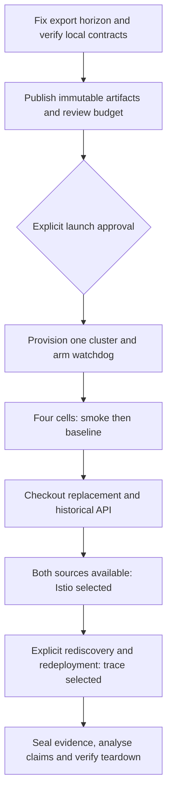
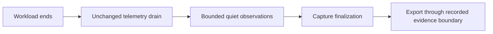

# Thesis completion v1

This protocol completes the remaining thesis evidence on one additional fresh GKE cluster. It uses the validated Karthos revision `4c2861b539fcd24d6a458dc0fd545fbdda5470d5`. No product behavior or public API change is planned. Local fixture and kind checks must qualify that exact revision before publication.

## Evidence and claims

| Claim | Local checks | GKE evidence |
|---|---|---|
| Structure and identity | Declared fixture: 11 entity kinds, seven directed relationships; replacement identity | Declared application structure, placement and common validated cross-deployment comparisons |
| Canonical metrics | Catalog contract, dimensions, units and known conversions | Coverage of all 43 entries; representative numerical accuracy across distinct mechanisms |
| Traffic and errors | Known counts, resets, HTTP/gRPC outcomes and source-specific policies | Both demos with trace-derived metrics and Istio |
| Temporal auditability | Traffic → idle → traffic, expiry, resets and retained replacement | Bounded checkout replacement/history observation |
| Arbitration | One selected contribution; explicit rediscovery/redeployment | Istio selected with both sources available, then trace selected after explicit replanning |
| API consumability | Five questions scored against independent expected answers | Current answers during cells and historical answers around replacement |
| Host and lifecycle | Exact transformations and identity-matching fixtures | Bounded numerical agreement, coverage and observation lag |

Exact local fixtures establish contract correctness. Live telemetry cannot establish exact kernel-read timing or collector-cache versions that the signals do not expose. Missing alignment remains insufficient evidence; it does not establish metric loss or a Karthos defect. Resource footprint is descriptive, without a causal-overhead claim.

## Execution

| Order | Cell or observation | Activity |
|---|---|---|
| 1 | Boutique trace | 60-second k6 smoke, then five-minute baseline |
| 2 | Astronomy trace | 60-second k6 smoke, then five-minute baseline |
| 3 | Astronomy Istio | 60-second k6 smoke, then five-minute baseline |
| 4 | Boutique Istio | 60-second k6 smoke, then five-minute baseline |
| 5 | Checkout history | Replacement and API observation, bounded at 720 seconds |
| 6 | Arbitration: both available | 60-second k6 window; verify Istio selection |
| 7 | Arbitration: replanned trace | Make owned Istio unavailable, rediscover and redeploy; 60-second k6 window |

There are **ten traffic windows and 26 minutes of scheduled traffic**, plus history and operational overhead. All traffic uses k6 at two journeys/second and runs serially. The 12-minute history bound includes observation, cleanup and publication according to the existing bounded history implementation; it is not an additional load window.

Readiness is traffic-free deployment, access, API-contract, source-configuration and export-access checking. It does not restore the former 13-probe suite. Healthy deployments are reused between smoke and baseline. Preserve the existing collection intervals, 250 ms clock gate, 60-second pre-roll, 90-second drain, bounded quiet checks, pairing capacity 10,000 and numerical tolerances.

Each attempt has its own identity and capture lifetime. The completion barrier verifies stopped traffic/capture, restored instrumentation, ownership and exported evidence before continuation. Recoverable operational failures have at most one labelled retry. Numerical disagreement is retained without a score-seeking retry. Gateway-outage, resource-stress, scale, GPU and causal-overhead claims are deferred.

## Export horizon

The ordinary and extended exporters share recorded evidence bounds. Export coverage includes the final relevant quiet/capture observations rather than assuming workload end plus 90 seconds. Record requested bounds, available samples and absent endpoints. Workload bounds, scoring instants and tolerances stay fixed.

Keep fixed-window fidelity, settled accounting and exact storage/API parity separate. Duration comparisons require equivalent populations and complete series identity. A later sample cannot be fabricated from an absent historical export.

## Historical comparison and reporting

The completed `thesis-repair-v2-aliasfix-20261113` run remains the first deployment for supported cross-cluster comparisons. Do not import its passes as new execution results. Compare common validated Boutique checks by logical identity, placement role, source selection, coverage and declared tolerances. Evidence newly available after this export fix supports new conclusions separately. The fresh four-cell run supports a same-harness source comparison for both demos.

Keep original sealed evidence in `results/` and new, versioned interpretations in `analyses/`, connected by checksums. The claim matrix records product/protocol/verifier versions, reference, comparison population, verdict and artifact. Report execution, evidence validity, application outcomes and numerical agreement separately. A percentage requires an explicit eligible denominator, not a mixture of comparison records or repeated capture hops.

## Launch and completion

Before provisioning, verify immutable digests and refresh billing, IAM, quota, GKE version availability and the complete time/cost forecast. Preserve the **12-hour infrastructure limit**, **US$80 projected launch threshold** and **US$100 combined gross ceiling**, including earlier spending. Credits do not reduce gross charges. A forecast conflict blocks provisioning and is presented for review.

Preparation and passing tests do not authorize cloud execution. Present the concrete launch package and obtain explicit chat approval. No approval-receipt command is needed.

Completion requires inspectable attempted evidence, verified primary and secondary exports, an explicit list of unconfirmed claims and verified temporary-resource removal. Passing every numerical comparison is not required. A demonstrated Karthos contract defect requires evidence, a narrow regression-backed fix and a new product pin before thesis qualification continues.

## Preparation and separate deployment comparison

Use `./gke-eval.sh prepare --schedule thesis-completion-v1 --config <reviewed-config> --id <new-run-id> --product-snapshot <exact-product> --product-lock <lock.json> --local-evidence <local-contract.json>`. Preparation remains offline and lists unresolved inputs. The active default is this protocol; historical definitions remain explicitly selectable.

`./gke-eval.sh compare-deployments --left <prior-manifest.json> --right <new-manifest.json> --left-sha256 <sealed-hash> --right-sha256 <sealed-hash>` produces a separate comparison. Each manifest binds run/cluster identities, identical product pins and scoring thresholds, and relative baseline directories with per-file hashes. Include bounded orchestration summaries, graph nodes/edges, placement versions and API-consumer ledgers. Missing comparisons remain insufficient; never import prior passes into the new run.

The evidence-horizon family checks exact recorded quiet endpoints independently of fixed-window parity. A population-matched settled duration can support representative accuracy only with verified horizon coverage and exact storage/API parity; the original duration verdict remains visible. Interval exports inherit the parent attempt's recorded evidence boundary.
