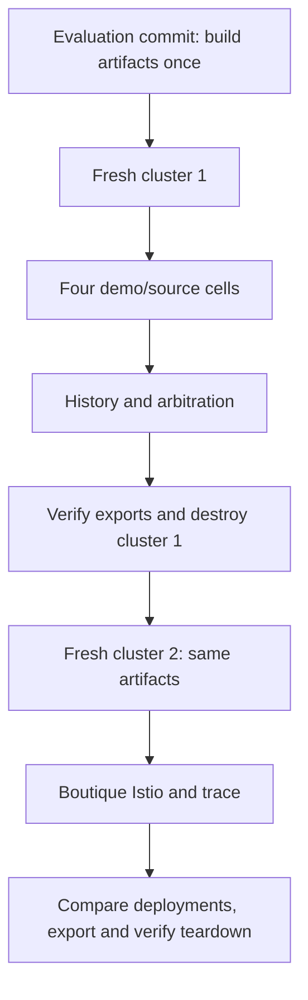
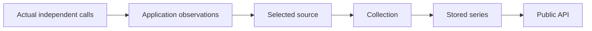

# Official thesis evaluation: completion v2

`thesis-completion-v2` is the official thesis evaluation, not a rehearsal. It runs two fresh GKE clusters sequentially from one evaluation commit and the same immutable images. Historical protocols and evidence remain unchanged; a historical run is not an input prerequisite for this protocol.

## Experiment and execution

Three fixed `e2-standard-4` workers are used per cluster: one observability/generator worker and two application workers. The controller is a separate `e2-standard-4` VM. The controller and protected evidence/state buckets survive the cluster rebuild; application and Karthos storage do not. All traffic is serial k6 at two journeys/second.

| Cluster | Order / scenario | Activity | Purpose |
|---|---|---|---|
| 1 | Boutique trace | 60-second smoke + five-minute baseline | Trace accuracy and structural fidelity |
| 1 | Astronomy trace | Smoke + baseline | Application portability |
| 1 | Astronomy Istio | Smoke + baseline | Source comparability |
| 1 | Boutique Istio | Smoke + baseline | Source comparability |
| 1 | Checkout replacement | Observation bounded at 720 seconds | Retained topology, placement and health |
| 1 | Both sources available | 60 seconds of traffic | Istio selection and single selected contribution |
| 1 | Explicit fallback | Rediscover/redeploy, then 60 seconds of traffic | Trace selection after owned Istio becomes unavailable |
| 2 | Boutique Istio | Smoke + baseline | Clean-cluster reproducibility |
| 2 | Boutique trace | Smoke + baseline | Clean-cluster reproducibility |

There are **14 traffic windows and 38 minutes of scheduled load**, plus history and operational overhead. The history bound includes its existing observation, cleanup and publication budget. Readiness checks deployment, API access/contract, source configuration, telemetry availability and export access without generating traffic. Idle traffic-series absence is not a readiness failure. Healthy deployments are reused between smoke and baseline; fresh attempt identities and capture lifetimes prevent evidence mixing.

Preserve the 250 ms clock gate, 60-second pre-roll, 90-second drain, bounded quiet observations, capture cadences and numerical tolerances. Servicegraph pairing capacity is 10,000; do not tune it during measurements. An operational failure permits at most one separately recorded retry; numerical disagreement does not trigger retries. Completion barriers require stopped traffic/capture, safe instrumentation restoration, resolved artifact recovery and verified primary export before proceeding.

## Claim coverage

Local fixtures establish exact behavior for controlled inputs. GKE tests behavior in the declared applications and conditions. Neither substitutes for the other.

| Claim or mechanism | Local contract check | GKE evidence |
|---|---|---|
| Structural fidelity | 11 entity kinds, seven directed relationship types | Declared Kubernetes objects, discovered structure and placement |
| Canonical identity | Cross-source resolution; same-name Pod replacement | Logical identity across sources and fresh clusters; separate runtime UIDs |
| Canonical metrics | Names, units, dimensions, aggregation and representative conversions | All 43 catalog entries inspected; representative numerical comparisons |
| Source arbitration | Priorities and resolved plans | Both available selects Istio; explicit rediscovery/redeployment selects trace |
| Avoiding double counting | Known observations from both sources yield one selected contribution | Capability, plan, mounted configuration, provenance and totals; doubled contributions rejected |
| Source comparability | Equivalent controlled observations normalize consistently | Common service identities/edges and selected request/duration populations on both demos |
| HTTP/gRPC errors | HTTP 404/500, HTTP 200 with gRPC 0/13, missing status and connector-native errors | Observed outcomes evaluated against each source's policy and derivation metadata |
| Temporal awareness | Traffic → idle → traffic, cumulative silence, resets and expiry | Observation bounds, freshness and lag; retained replacement observations |
| Historical queries | Retained snapshots and source-filtered history | Independent before/after replica, placement and health inventory |
| Counter/query semantics | Gauge, cumulative/delta, resets, rates and increases | Fixed-window, settled accounting and storage/API comparisons remain separate |
| Duration correctness | Known sums/counts, weighted means and incompatible populations | Matching source populations; independent proxy timing remains separate |
| Resource accuracy | Known conversions, volume identity and lifecycle association | Aligned container/volume measurements; bounded host comparisons reported separately |
| API-only consumption | Known independent answers and API schema | Five questions scored without Kubernetes/database credentials |
| Clean-deployment reproducibility | Comparable-input hashes | Boutique on two fresh clusters with identical artifacts and scientific settings |
| Auditability | Missing/ambiguous/contradictory evidence cannot earn a pass | Boundary records, provenance, timestamps, checksums and explanations |
| Component footprint | No causal-overhead assertion | Describe application, Karthos, generator and evaluation instrumentation separately |

The five API-only questions are: who called checkout during an interval; which replicas exist and where; which replicas and health existed before/after replacement; how a selected container's CPU/memory changed; and which source/rule produced an error count. Successful HTTP responses alone do not establish correct answers.

## Complete metric coverage

Every catalog entry is checked for its contract (name, units, registered sources and aggregation) and inspected for deployed source assignment, storage/API visibility, freshness and preserved dimensions. Availability does not establish numerical accuracy. Classify absent evidence as missing-expected, unsupported-source, not-applicable or not-exercised according to independent expectations.

### 18 metrics selected for live comparison

Selection means comparison is attempted, not that missing alignment may pass. Traffic, container and volume measurements are the primary representative numerical evidence. Host/lifecycle comparisons retain their own timing limitations. No stress workload is added to force a metric to change.

| Metric | Reference / evaluation |
|---|---|
| `container.cpu.usage` | Aligned kubelet/container measurement; cores |
| `container.memory.usage` | Aligned kubelet/container measurement; bytes |
| `k8s.pod.volume.available` | Matching volume, producer and measurement; bytes |
| `k8s.pod.volume.capacity` | Matching volume, producer and measurement; bytes |
| `system.cpu.utilization` | CPU-state/tick reference with explicit interval alignment; ratio |
| `system.memory.usage` | Matching host memory-state reference; bytes |
| `system.disk.io.read` | Device/direction and monotonic counter brackets |
| `system.disk.io.write` | Device/direction and monotonic counter brackets |
| `system.filesystem.usage` | Matching filesystem/mount and observation time; bytes |
| `system.filesystem.utilization` | Matching filesystem/mount and observation time; ratio |
| `system.network.io.receive` | Matching interface/direction and counter brackets |
| `system.network.io.transmit` | Matching interface/direction and counter brackets |
| `k8s.container.ready` | Independent readiness and container lifecycle |
| `k8s.container.restart.count` | Same runtime/object observation; do not assume perpetual monotonicity |
| `k8s.pod.status.phase` | Independent Pod phase and lifecycle |
| `servicegraph.request.count` | Actual request/application records → source → storage → API |
| `servicegraph.request.duration` | Matching duration sum/count populations; seconds |
| `servicegraph.request.error.count` | Preserved outcomes and source policy; intentional/unexpected failures separate |

Request/error and I/O metrics expose different units for cumulative values, increases and rates. Bind query mode/window and source/status dimensions before comparing. Missing kernel-read timestamps or cache versions cannot establish exact alignment or metric loss.

### 25 metrics with contract and visibility coverage

These are not independently qualified for live numerical accuracy by this protocol.

| Metric | Catalog unit (default query) |
|---|---|
| `k8s.pod.cpu.usage` | `cores` |
| `k8s.pod.memory.working_set` | `bytes` |
| `k8s.node.cpu.usage` | `cores` |
| `k8s.node.memory.working_set` | `bytes` |
| `k8s.pod.volume.inode.free` | `count` |
| `k8s.pod.volume.inode.used` | `count` |
| `k8s.pod.volume.inode.count` | `count` |
| `system.disk.operations` | `per_second` |
| `system.network.errors` | `per_second` |
| `k8s.container.cpu.request` | `cores` |
| `k8s.container.cpu.limit` | `cores` |
| `k8s.container.memory.request` | `bytes` |
| `k8s.container.memory.limit` | `bytes` |
| `k8s.pod.status.reason` | `count` |
| `k8s.node.condition.ready` | `count` |
| `k8s.node.condition.memory_pressure` | `count` |
| `k8s.node.condition.disk_pressure` | `count` |
| `http.server.request.count` | `per_second` |
| `http.server.request.duration` | `seconds` |
| `servicegraph.grpc.request.message.count` | `per_second` |
| `servicegraph.grpc.response.message.count` | `per_second` |
| `servicegraph.tcp.connection.open.count` | `per_second` |
| `servicegraph.tcp.connection.close.count` | `per_second` |
| `servicegraph.tcp.bytes.sent` | `bytes_per_second` |
| `servicegraph.tcp.bytes.received` | `bytes_per_second` |

## Explanations and verdicts

Each supported comparison reports population, expected/observed values, time bounds, missing evidence and the first demonstrable boundary discrepancy. Diagnostic logs support cause attribution only when they establish it; otherwise the report says **exact cause unknown**. A source/storage count difference alone does not prove collector drops or identify which requests were lost.

Keep execution, evidence validity, application outcomes, numerical agreement and claim confirmation separate. Excluded exact kernel/cache alignment is not applicable; missing required evidence is insufficient. Fixed-window fidelity, settled accounting and API/storage parity are distinct. Export through recorded drain, quiet-observation and finalization boundaries while keeping scientific query windows unchanged.

Compare fresh deployments only after binding product, workload scripts/routes/outcome rules, collection settings and scoring hashes. Different generated names and measured readings are expected; compare logical roles and declared tolerances. Different trace/mesh error policies are not required to yield identical counts for semantically different error populations.

A percentage requires an independently established eligible denominator. Do not report a universal metric-loss rate from heterogeneous comparison rows or repeated forwarding copies. Original evidence belongs in `results/` and GCS; versioned interpretations belong in `analyses/` and refer to original checksums. Retries never replace failed attempts.

## Reproduction, launch and acceptance

Follow the [README](../README.md) from an evaluation commit. The build fetches exact dependency references and records image digests. Account-specific settings are separate. New execution does not require prior results or private work directories. Local fixture/kind qualification is evidence for the pinned product, not live GKE proof.

Before launch, refresh registry, IAM, quotas, versions, billing and the complete two-cluster time/cost forecast, including rebuild, retries, history, capture/export, secondary verification and cleanup. Preserve the **18-hour infrastructure limit**, **US$90 projected launch threshold** and **US$270 combined gross ceiling**, including prior spending. Credits do not reduce gross cost. The previous ten-window forecast does not establish that this protocol fits; unresolved forecast conflicts block launch. Explicit launch approval remains required in assisted execution.

Primary exports, quarantine originals and secondary backups remain private and checksum-bound. Retain raw evidence for 90 days under the existing no-automatic-deletion policy; state and credentials do not enter research bundles. Ownership-safe teardown removes temporary resources and leaves protected evidence/state intact. Operator closure verifies secondary exports and provider-side cleanup rather than assuming controller exit proves removal.

Acceptance requires both cluster lifetimes and all phases accounted for, inspectable attempted evidence, explicit unconfirmed claims and confirmed exports/cleanup. Passing every numerical comparison is not required.

## Boundaries of the conclusions

Three workers exercise cross-node attribution, placement and multiple collector instances. Boutique and Astronomy provide production-like microservice architectures, not a production-scale capacity benchmark. Two deployments support bounded reproducibility, not a statistically robust variance estimate. This protocol excludes induced-throttling resilience, Gateway-outage resilience, GPU, automatic runtime source failover and causal overhead. Raw request/span evidence retained by the evaluation must not be described as universally retained by Karthos itself.

## Bounded claims and traffic population preflight

For Istio, the primary duration comparison uses the matched settled population
inside the originally declared drain export, with the existing population,
histogram synchronization, unit and numerical checks plus required export-horizon
evidence. `fixed_window_traffic_duration` and exact API/storage parity remain
separate. Missing settled evidence cannot be replaced by a fixed-window pass.
Host and lifecycle observations do not establish exact kernel-read or collector
cache alignment. Their descriptive coverage and conservative reference-state
observation intervals do not upgrade insufficient exact accuracy evidence.
The active bounded-lifecycle-v1 observation retains independent Kubernetes
acquisition intervals and matching API acquisitions around the existing checkout
replacement. It reports conservative controller-observed elapsed bounds, not the
exact collector/cache transition or internal ingestion latency. See
[bounded lifecycle observations](bounded-lifecycle-observations.md).

Before setup completes, and again before each traffic attempt including reused
deployments, `traffic_population.verify` checks the pinned native generators:
Boutique `loadgenerator` (`app=loadgenerator`) and Astronomy `load-generator`
(`app.kubernetes.io/component=load-generator`). The identities come from the
pinned cached upstream charts. A matching Deployment must have desired and
observed replica counts zero and its generation reconciled; no matching active
or terminating Pod may remain. Absence from complete inventories is acceptable.
The guard is read-only and writes `traffic-population-preflight.json`; missing
inventory or an active known generator blocks traffic without deleting workloads.

HTTP health-probe routes are recorded from actual PodSpec declarations, with no
inferred request count. They are outside declared business journeys, but no raw
telemetry rows are suppressed. No background route list is invented: undeclared
traffic remains unclassified and cannot be silently subtracted from the measured
population. The guard does not prove all traffic belongs to the controlled load;
existing population/identity checks still decide that. Existing request/journey
IDs are retained without adding metric labels. The sequential inventory
acquisition bracket is not an atomic cluster snapshot or a guarantee against
later external changes.

The trace settled population check and fixed-window diagnostics are documented in
[trace settled population](trace-settled-population.md). The active protocol
records settled-primary-v1 and bounded-lifecycle-v1 explicitly without changing
the fourteen traffic windows.

## Complemento de robustecimento

O perfil adicional Boutique, orçamento em BRL, regras retrospectivas e limites das afirmações estão em [thesis-robustness.md](thesis-robustness.md). As regras de orçamento acima descrevem a execução histórica completa; não substituem o teto adicional de R$ 1.200 do complemento.
