# Thesis qualification v2 (historical)

Retained for analysis of original evidence. New preparations and launches use [thesis qualification v3](thesis-qualification-v3.md).

This protocol starts from Karthos revision `f37f408dea46abfcfdfbdc6a32c06ac2a353d9ef`. It keeps the 16-window rehearsal and 46-window qualification available under their original schedules. Earlier evidence keeps its original product and verifier versions.

```mermaid
flowchart LR
    Local["Pinned local contract checks"] --> Prepare["Offline bundle and launch review"]
    Prepare --> Ready["Cluster 1 · 17 mandatory readiness probes"]
    Ready --> Reset["Verify exports and reset probe state"]
    Reset --> C1["Cluster 1 · four k6 smoke/baseline pairs"]
    C1 --> History["Checkout replacement · bounded history observation"]
    History --> Rebuild["Rebuild GKE with fresh storage"]
    Rebuild --> C2["Cluster 2 · two Boutique smoke/baseline pairs"]
    C2 --> Verdict["Seal claim matrix and verify teardown"]
```

Each measured pair contains a 60-second smoke followed by a five-minute baseline at two journeys per second. Cluster 1 runs Boutique trace, Astronomy trace, Astronomy Istio and Boutique Istio. Cluster 2 runs Boutique Istio and Boutique trace. The 36 measured traffic minutes and the 21 readiness traffic minutes fit within the shared 12-hour infrastructure limit only if the measured forecast also accounts for setup, processing, export and cleanup. The history observation has a separate 12-minute bound within that limit. Locust remains in readiness.

## Evidence and verdicts

| Claim | Independent reference and comparison |
|---|---|
| Structural fidelity and identity | Kubernetes fixture declarations and live inventory. Check 11 graph entity kinds and seven directed relations within the declared scope. Recreate a same-name Pod, compare its UID and stable canonical ID, and inspect each recorded placement. |
| Source semantics | Pinned VictoriaMetrics integration cases for classified and unknown outcomes, temporality, resets and connector provenance. Validate representative request and duration populations with the observed telemetry and independently recorded calls. |
| Source independence and arbitration | Compare controlled checkout accounting and canonical service identities across sources for each demo. In local qualification, verify the one selected contribution while both inputs are available and after explicit rediscovery and redeployment. |
| Temporal auditability | Compare idle cumulative scrapes and the edge observation bound, then check advancement after new traffic. Use retained snapshots and observed health around replacement, and fixtures for reset, source filtering and expiry. |
| API-only consumption | Validate API envelopes against the pinned OpenAPI contract. Score declared callers, replicas and placement, retained health, container resource history and error derivation against independent observations. |
| Clean-cluster reproducibility | Compare both Boutique deployments by logical names and owner chains, placement slots, selected sources, independently scored API answers and request accounting under frozen tolerances. |

All 43 catalog contracts are checked for names, units, sources and aggregation. Coverage is reported separately from numerical accuracy. The verifier records source accuracy, API/storage parity, fixed-window agreement and missing evidence separately. Query-time Istio errors apply the HTTP 5xx or present nonzero gRPC status policy. Trace error counts retain connector-native semantics. Collection and query footprints describe the deployment observed. The deployment stores metrics and topology in its own VictoriaMetrics and PostgreSQL instances. GCS stores evaluation exports.

## Preparation and launch review

The local receipt generator reads recorded evidence under an attempt directory and binds its files to the explicit source lock. The required records are `structure.json`, `source-semantics.log`, `arbitration.json`, `temporal-history.json` and `api-only.json`. Each absent or invalid record leaves the receipt incomplete. See `evaluation/diagnostics/thesis_local.py` for the fixture input contracts.

`gke-eval.sh prepare --schedule thesis-qualification-v2` takes an explicit product snapshot, product lock and local evidence receipt. The product lock identifies source, chart, OpenAPI contract and immutable product images. Historical timings, tolerances and demo pins are recorded separately. Preparation can render a partial review with unresolved artifact or evidence inputs. Technical readiness rejects an incomplete receipt or an incomplete prepared manifest.

Before requesting launch approval, review the exact published digests, GKE version, cost, quotas and timing forecast. Retain the US$80 projected threshold, US$100 gross ceiling and cleanup reserve. The 10h48m planning estimate uses historical timings and is subject to fresh observations during readiness.

Sealed window exports and the final `claim-matrix.json` live under the existing run-ID evidence namespace. Each claim records the reference, verdict, revision and artifact link or checksum. Offline analyses use new analysis IDs and record checksums of the original inputs.

### Live kind notes

The pinned Istio detector requires complete mesh coverage across non-system, controller-owned workloads. On the disposable kind cluster, the local storage provisioner caused a partial-mesh verdict even though all demo pods were injected. Temporarily stopping that provisioner after storage was bound, then repeating discovery and restoring it, isolates this condition. Record the original and repeat profiles. The GKE gate uses live discovery and preserves the verdict for its own workload inventory.

Use `evaluation.diagnostics.thesis_kind` with an explicit disposable kind context to capture a same-name Pod replacement across two nodes. It creates a dedicated namespace and deletes it using the creation UID. The capture records the original snapshot, replacement snapshot, and a separate read of the original snapshot after replacement.

### Controlled fixtures

Run the Go helpers as single files from the pinned Karthos checkout so they import the reviewed product packages. `qualify_duration.go` checks a known mean in an isolated VictoriaMetrics instance selected through `KARTHOS_TEST_VM_URL`. `qualify_temporal.go` feeds controlled cumulative scrapes to the ingest and observation stores. `qualify_api.go` serves declared graph, health and metric values through Karthos's HTTP handlers on loopback and prints a handshake with the endpoint and bounds. Pass the handshake file and pinned OpenAPI to `evaluation.diagnostics.thesis_api_fixture`. The fixture deliberately uses small pages, a second namespace with the same service name, and two historical snapshots. The seeded answers qualify the query contract. GKE scores the same question classes against its own independent live records.

### Claim evidence and history continuation

The baseline consumer's caller answer is compared against the independently
observed caller set within the declared checkout scope, by canonical identity,
observation source, and interval. The error answer records source and derivation
provenance separately from the numerical comparison. A verified export preserves
invalid evidence for investigation. Passing credit requires valid evidence for
the individual claim.

The replacement observation reserves time for consumer cleanup and evidence
export within its 12-minute bound. A missing or delayed snapshot is insufficient
evidence for the historical claim. A verified partial export and safe cleanup
permit the second cluster to proceed. Unverified export or unsafe cleanup stops
new traffic.
