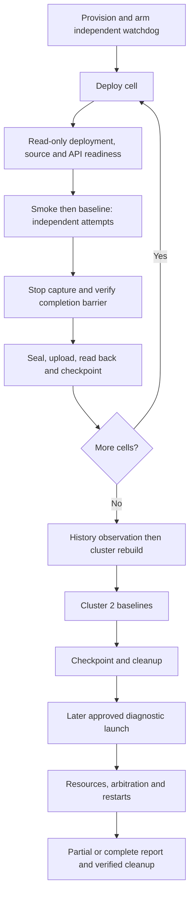
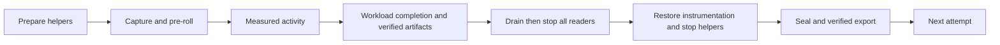

# Thesis qualification v4: independent attempts

V4 replaces the 13-probe launch gate with per-deployment, read-only readiness. It uses the pinned Karthos product unchanged. Historical protocol definitions and evidence retain their versions.

## Execution



| Phase | Windows | Scheduled traffic |
|---|---:|---:|
| Cluster 1: four smoke/baseline pairs | 8 | 24 minutes |
| Cluster 2: two smoke/baseline pairs | 4 | 12 minutes |
| CPU/memory, PVC I/O, cross-node traffic | 3 | 15 minutes |
| Both-source Istio selection then explicit trace rediscovery/redeployment | 2 | 10 minutes |
| Checkout/Gateway replacement under each source | 4 | 20 minutes |
| Total | 21 | 81 minutes |

The 720-second historical API observation is additional. Diagnostics run in a later approved launch after both thesis clusters' baselines. k6 is the only generator. Workload rates, durations, clock bounds, pre-roll/drain and numerical tolerances are unchanged.

Readiness generates no traffic and creates no helpers. It observes deployments/rollout generations, selected mounted configuration, API catalog/graph and available resource telemetry. Idle request-counter absence is not a failure. Independent checks are retained even if another fails. Existing deployment timeouts apply; extra observations have a 120-second budget. A verified small export follows. A healthy deployment's receipt is reused for its smoke/baseline pair; recovery creates a new receipt.

## Completion and retry policy



One cleanup path handles success/failure/timeout. `transition.json` reports actual Job/Pod absence, worker/proxy termination, instrumentation restoration, helper cleanup, timestamps and outstanding failures. Measurement validity and continuation safety are independent. A missing CPU reference can invalidate resource agreement without preventing a safe later window. Heavy export never follows an unsafe capture barrier; only stopped supplementary diagnostics enter the final failure export.

Recoverable execution/application/evidence failures receive at most one labeled retry. Numerical disagreements with valid evidence receive no score-seeking retry. A failed smoke does not prevent an independently runnable baseline. Ownership ambiguity, uncontrolled traffic, restoration/export failure, exhausted storage/budget/deadline and demonstrated product defects stop new traffic. Artifact completeness-before-ACK and the bounded 30-minute recovery hold remain intact. Job absence alone is insufficient: generator Pods must disappear too.

Healthy deployments are reused; attempts have fresh IDs (`<logical-window>-a1`, `-a2`), directories, generator Jobs and capture instances. Explicit restart isolation and recovery can redeploy. Every attempt remains in `attempts.json/csv` and the HTML matrix. The first complete observation with valid evidence is the representative result, even if it numerically disagrees or has unexpected application outcomes. A later success never deletes the first outcome. The representative result and retry-policy completion are recorded separately.

## Diagnostic evidence

See [execution diagnostics](execution-diagnostics.md) and [minimal readiness](minimal-readiness.md). Five-second supplementary collection records lifecycle, normal/init/restartable-init containers, current/previous logs, events, controller CPU/memory/I/O, actual collection cadence and failures. Logs are bounded to 2 MiB per instance and 256 MiB per attempt. Missing, rotated, ambiguous or truncated logs remain explicit and are not numeric oracle evidence. Required ledgers/raw references retain their own completeness rules.

Kubelet requests preserve connect/request/header/body timings and original exceptions. A one-second sampling target is distinct from its five-second request timeout; acquisition failures and missed samples are recorded without altering metric tolerances. Proxy process IDs and termination statuses are retained.

Resource helpers bind PVCs, pull images and establish servers before measurement. CPU/fio/network-client commands wait on an explicit release gate; release follows the observed generator WINDOW marker. Actual activity start times are retained, not assumed equal to generator start. Volume reference collection spans preparation and ends gracefully when stimulus completes. Helper deadlines include bounded preparation; remaining lifetime must cover activity and completion allowance. Incomplete overlap remains reportable.

## Checkpoints and continuation

Each exported attempt advances an immutable phase checkpoint. It retains records, representative reports, graph/placement documents, history, readiness, cluster/node identities and predecessor links. The exporter redacts before sealing; receipt hashes refer to those exact published bytes. The local receipt is under `checkpoint-receipts/`; the published projection is under `checkpoint-projections/`.

To prepare an explicit continuation, download a sealed GCS checkpoint and its saved export receipt, then add these arguments to the existing prepare invocation:

```sh
./gke-eval.sh prepare --config <config.json> --id <new-id> \
  --product-snapshot <pinned-snapshot> --product-lock <product-lock.json> \
  --local-evidence <existing-local-contract.json> \
  --continuation-dir <downloaded-checkpoint> \
  --continuation-receipt <checkpoint-export-receipt.json>
```

Preparation validates checksums, product/protocol/scoring/implementation binding and window identities. Completed windows are retained; blocked/unattempted work resumes. Interrupted attempts may consume their remaining single retry. Separate cluster incarnations always retain separate identities. The original source paths become predecessor references, not claims about the new VM. Cloud ownership/lease and deadline/budget gates still apply. A continuation requires its own launch review; it does not silently extend a prior infrastructure deadline.

## Preparation and launch boundary

No cloud execution is authorized by creating these files. Before launch, package and publish an immutable controller, refresh account/quota/version/cost checks, and review the exact manifest in chat.

Preparation now requires `readiness.phase_estimates_seconds`: positive finite `provision`, `rebuild`, `setup`, `capture_setup_restore`, `export`, `history`, and `retry_reserve` values based on reviewed archived timings. `export` must include attempt publication and checkpoint work. The forecast includes readiness observations and publication, quiet-counter bounds, all planned windows, history and cleanup. Missing estimates or a forecast over 12 hours block launch; do not silently reduce windows or omit cleanup. Retry reserve is bounded, not a guarantee that all worst-case retries fit. Deadline exhaustion leaves unfinished work explicit.

Limits remain 12 infrastructure hours, US$80 projected launch threshold and US$100 gross planning ceiling. Cost estimates and a watchdog are not a hard billing cap. Raw evidence remains in private GCS, original execution evidence under `results/`, and versioned interpretation under `analyses/`.

Implementation validation deliberately excludes workload simulations, archive benchmarks and a separate live rehearsal. Static syntax/configuration checks and code review do not prove cloud runtime correctness. The first approved GCP launch provides that evidence.


## Approved split launch (2026-11-12)

The frozen 21-window study is split into `execution_segment: thesis` (12 smoke/baseline windows plus history on two clusters) and `execution_segment: diagnostics` (nine windows on a later fresh cluster). Each infrastructure launch retains its 12-hour limit; the combined gross planning ceiling remains US$100. Reviewed allocations must be at most US$80 per launch and sum to at most US$100. Shared evidence retention and transfer allowances are charged once in the study estimate. This is a planning allocation, not an automated hard billing cap.

The first segment seals its completed phases and reports `segment-complete`, not a completed qualification. The other nine windows are explicitly deferred. The diagnostic segment requires a verified predecessor checkpoint accounting for every thesis window; its forecast considers only pending diagnostic work, without a second thesis history/rebuild charge. Existing study-wide raw evidence usage carries forward. A diagnostic continuation uses a new physical cluster identity and does not create a third reproducibility baseline. Each launch still requires explicit approval; diagnostics do not auto-launch after teardown.

The Billing management API (`cloudbilling.googleapis.com`) must be enabled. The launch billing check explicitly uses `--billing-project=<evaluation-project>` to avoid the shared Cloud SDK request quota. This API prerequisite was enabled during the2026-11-12 prelaunch refresh; it creates no compute resources.
