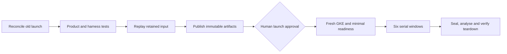

# Targeted ingestion-repair validation v1

This is a new one-cluster study, not continuation or completion of the old two-cluster qualification. Product and controller pins change. Historical failed attempts remain unchanged.

## Frozen schedule

| Cell | Smoke | Baseline | Original logical population |
|---|---:|---:|---|
| Boutique trace | 60 seconds | 300 seconds | Previously unattempted repetition 2; regression control |
| Astronomy Istio | 60 seconds | 300 seconds | Failed baseline; fresh smoke prerequisite |
| Boutique Istio | 60 seconds | 300 seconds | Previously unattempted repetition 2 |

All windows use matched k6 at two journeys/second. New physical identities retain `origin_id`; origin rows are provenance only. There is no Locust, readiness traffic, history replacement, rebuild or diagnostic-helper phase. Resource sampling of the application remains enabled. Preserve frozen tolerances, clock gate, pre-roll/drain and quiet-counter bounds.

Minimal readiness checks deployment, placement, selected configuration, Kubernetes/API/catalog access, available telemetry and export/readback. Missing idle request counters are descriptive. Keep independent attempts, one operational retry and safe smoke-to-baseline handoff; numerical disagreement never triggers retries.

## Evidence and verdicts

`results/` contains immutable execution artifacts; `analyses/` contains versioned interpretations linked to source checksums. The manifest references the original sealed report and seal hashes without importing old passes. The analysis expands actual attempt IDs, including failed retries.

Independent numerical resource scoring includes only declared metrics. Dedicated traffic comparisons retain request/error/duration populations. Catalog visibility is coverage, not numerical accuracy. Unknown reference times or ambiguous node/container/volume identities stay insufficient. Report denominators alongside pass/fail/insufficient/not-applicable counts; never present observed samples as an independently expected population.

Historical API replacement and two-cluster reproducibility are explicitly not applicable to this repair run. Missing Astronomy trace means this run alone cannot establish Astronomy source independence. Keep these broader thesis claims deferred.

## Capture and recovery

Supplementary container logs use immutable incremental chunks with complete-timestamp cursors, raw hashes and explicit overlap/gaps. Limits remain 2 MiB per concrete instance and 256 MiB per attempt. Required oracle streams are separate and retain completeness-before-ACK. Collector file capture appends and flushes every second without rotation; the existing 512 MiB volume/export bounds still apply and are not instantaneous write caps.

Completion barriers verify stopped traffic, joined capture workers, restored instrumentation, removed helpers and verified exports. An idle artifact-recovery container must be ACKed or handled under the existing 30-minute policy before another generator starts. Monitor classification alerts on new physical failures, does not treat recovered rows as new failures, and continues until both a final seal and verified temporary-resource removal exist. Observation timeouts leave controller state unknown.

GKE bootstrap and permanent node pools use the dedicated node service account. Cleanup may reconcile a terminally rejected cluster request only with matching creating principal, intent time/resource, authoritative audit rejection, no accepted create operation, no UID binding and current provider absence. Missing permissions or uncertain operations keep the intent pending. Protected foundation and historical evidence are never destroyed.

## Preparation and launch boundary

Use `./gke-eval.sh prepare --schedule thesis-repair-validation-v1` with explicit product snapshot/lock, current local-contract evidence, and `--origin-report`, `--origin-seal`, `--origin-uri`. Repair preparations require execution segment `all`; strict continuation remains unchanged and is forbidden for this changed-product repair run.

Review artifact digests, current cloud prerequisites, observed-phase forecast, previous gross spend and the US$100 combined ceiling before launch. Retain the US$80 projected launch threshold and 12-hour infrastructure deadline. Credit balances are recorded separately from gross spending. Files/tests/publication do not approve provisioning: explicit chat approval is required.
